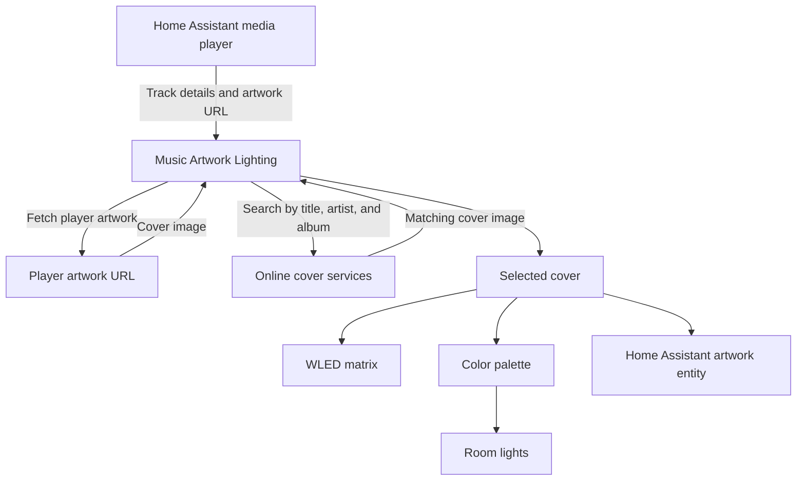

# Music Artwork Lighting

Show the current album cover on a WLED matrix and color the room to match the music.

## Features

- **Album covers on a WLED matrix.** Show static or animated artwork and choose how it fits and transitions.
- **Room lights that match the music.** Use colors from the current cover, with or without a matrix.
- **Cover lookup.** Use the player’s artwork or search online for missing covers and animated alternatives.
- **Dashboard artwork.** Add the current cover and its palette to a Home Assistant dashboard without any lights.
- **Playback controls.** Prioritize players, set what happens when music stops, and configure each matrix independently.

## Where the cover comes from

With online search enabled, the integration can fetch a missing cover or look for an animated version of a static player cover. You can choose MusicBrainz and Cover Art Archive, Deezer, Last.fm, and TheAudioDB in the settings.

## Setup

1. Install from Home Assistant Marketplace and restart Home Assistant.
2. Go to **Settings → Devices & services → Add integration → Music Artwork Lighting** and choose a media player. Add more players in **Configure** to set their priority.
3. Pick color-capable room lights and, optionally, a matrix light from the built-in WLED integration. Matrix artwork needs WLED 0.16.x with the Image effect and PixelForge playback support. Add one entry per matrix and assign each physical light to one entry.
4. Choose what the matrix and room lights should do when playback ends.

Use **Automatic control** to pause the integration, or turn off **Matrix artwork** to keep room-light matching on its own. Disable **Search online for cover art** to use the artwork your players provide.

[Dashboard examples, tuning, and troubleshooting](https://github.com/vibribbonee/wled-album-art/blob/main/docs/guide.md) · [Changelog](CHANGELOG.md)

## Contributing

Pull requests are welcome. Describe the change and how you tested it.

[MIT license](https://github.com/vibribbonee/wled-album-art/blob/main/LICENSE). OpenAI Codex assisted with development, testing, and documentation.
